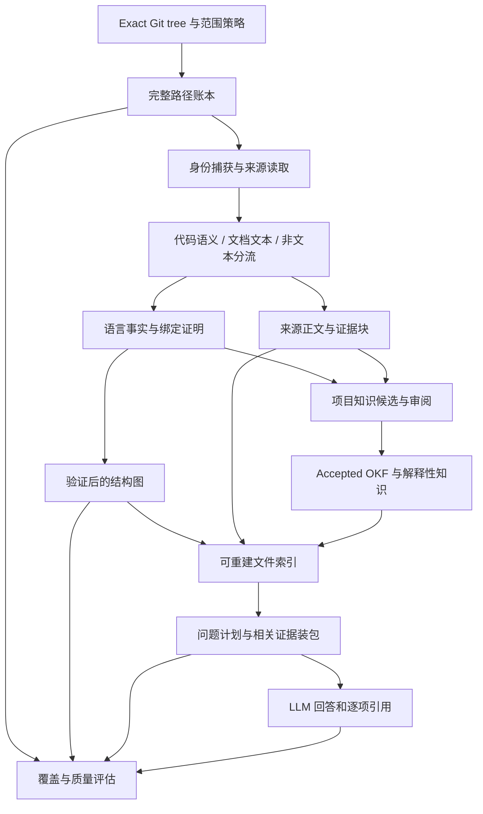

# GTKG V0.4 知识质量与召回改进方案

本方案由 Agent Nine Desktop 知识库的实物评审、生成历史和代码根因分析形成。目标是让知识库在**固定源码版本、声明的能力范围、独立问题集和资源预算内**，支持可靠的项目理解与知识召回；不承诺任何 LLM 对任意问题都能“全面理解”。

**方案决策：保留 V1 历史产物，通过 V2 的显式能力修订补齐完整来源分母、混合文件路由、Go 静态分析、可信关系、语义知识和证据上下文，并单独验收真实问答效果。** 不通过修改 Skill 提示词掩盖 Core 缺口，也不把“切到 V2”本身当作问题已解决。

本轮只交付此方案文件。产品代码、Skill、既有 PRD/TaskList、知识库、安装配置及 Current 均不修改；不运行产品测试、重新生成知识库或调用模型生成业务摘要。

## 1. 方案身份与继承关系

| 项目 | 本方案使用的事实或边界 |
|---|---|
| 方案存放位置 | `/Users/Rou/dev_projects/GTKG/V0.4KnowledgeQualityPlan.md` |
| 根 checkout | `codex/checkpoint-v0.2-r3`，HEAD `54364d584888bf291b7e87813a3546b3ee4926d8` |
| 实现审查基线 | `/Users/Rou/dev_projects/GTKG/develops/v0.3`，分支 `codex/develop-v0.3`，HEAD `5c0162068e319c9d9d5192fff7fac497d57f353a` |
| 规格基线 | 以开发工作树的 `V0.3PRD.md` r3 和 `V0.3TaskList.md` 为实现对照；根目录仍保留较早规格副本 |
| 目标仓库 | `/Users/Rou/dev_projects/agent-nine-desktop` |
| 目标源版本 | commit `b219175c7c266915c13d987b7768fcf70cf3cbdf`；tree `f86ccc1d260d816121f50ecd62acff81220f4401` |
| 旧知识包 | `v0.1.0--e2ccbff16020`；tree digest `sha256:e2ccbff16020b394fe93dafe75fd68d895a7584c37e75b908dea33b0131415a3` |
| 历史开发状态 | 现有 TaskList 记录 35/44 accepted，B01 blocked；本方案未重新审计整套历史执行证据，不将其升级为当前全部通过 |
| 本方案状态 | 规格提案；所有新增实现、迁移、Runtime、Benchmark、Release、Installation、Current、Business 验收均为 `not_run` |

源文件身份见附录 A。本文使用的 `QK-*` 编号是**补充需求和候选工作包**，不自动加入原 44 节点分母，也不更改已有 accepted 状态。后续进入开发时，需要按实际受影响面建立 successor plan 和证据修订。

## 2. 评审事实与根因归属

### 2.1 已确认事实

旧知识包捕获 1,067 个文件；当前固定 Git 树有 5,104 个跟踪文件。精确对账为：

```text
5,104 = 1,196 个 include 范围外文件
      +    53 个命中 exclude 的文件
      + 2,788 个格式不支持/无扩展名文件
      + 1,067 个入库文件

2,584 个 Go = 2,503 个所选范围内不支持 + 81 个范围外
```

七个核心内部域 agent/control/memory/config/tool/provider/cli 共 823 个文件，仅捕获 3 个测试 JSON；前端捕获 620/646。文件比例不等于语义理解率，但核心实现缺失足以阻断全项目理解验收。

本次前序评审重新执行 `bundle.verify` 为 valid，4,282 条文件校验记录全部匹配，1,067 份正文与静态提取文本一致。由此证明产物内部一致，不能证明关系、摘要或答案正确。

前序评审最初未定位到 1,249 个路径的原因；后续已从检查收据嵌套 `checkouts` 找到原始 include/exclude，并完成集合对账，未解释路径为 0。本文采用纠正后的结论。

### 2.2 根因清单

| ID | 根因 | 责任层 | 直接证据 |
|---|---|---|---|
| RC-01 | 本次执行显式选择不完整 include/exclude；范围外项目未纳入遗漏报告 | 执行参数 + V1 范围记账 | S01、S02 |
| RC-02 | V1 提取器白名单、dispatch、语言类型无 Go；V2 native 仍复用四语言提取链 | Core 能力 | S03、S10 |
| RC-03 | `needs_llm` 后用 jq 给 `analysis_text` 逐行加 `> `，替代 host-model 总结 | 执行选择 | S04 |
| RC-04 | 无 claim 摘要可通过；模型声明不是执行证明；完整性门禁未定义问答质量 | Core 验收边界 + Skill 验收缺口 | S05、S08 |
| RC-05 | V1 只保留调用末端名称，再按全局同名唯一候选绑定，混淆语言、接收者和变量 | Core 解析与绑定 | S06 |
| RC-06 | 架构标题和概述硬编码 GTKG；五视图复制完整清单；首非空行被当摘要要点 | Core 生成器 | S07 |
| RC-07 | V1 全词项 AND、错误码拆词、首词项片段及分数并列 conflict | Core 检索 | S09 |
| RC-08 | Skill 固定 V1 路径，缺主语言匹配和知识质量门禁；实际执行未履行其模型摘要步骤 | Skill 路由/验收 + 执行一致性 | S08、S04 |
| RC-09 | V2 分析入口限制 1–256 selections；使用 native 时要求其集合等于全部 inventory，混合大仓无法正确分流 | V2 计划合同 | S10 |
| RC-10 | V2 本地 resolver 仍采用同文件同名唯一规则；Graph v3 验字节后继承上游 resolution | V2 语义证明边界 | S11 |
| RC-11 | V2 已有高效结构索引，但自然问句、相关性排序、正文片段及面向问题的 context pack 不完整 | V2 查询/上下文交付 | S12、S13 |
| RC-12 | B00 问题分母已冻结但 gold 尚待标注，正式问答/竞品验证未完成 | 评估证据缺口 | S14 |

RC-01—RC-08 解释旧产物；RC-09—RC-12 是本轮深入 V0.3 真源后发现的实施前置条件。不能将旧 V1 的缺陷全部归到 V2，也不能借 V2 已有部分能力忽略这些新缺口。

## 3. 对 V0.3 现有能力的判断

| 领域 | 已有、应复用 | 本方案要求新增或修订 |
|---|---|---|
| 来源 | V2 Git capture 不按扩展名过滤，保存 path/hash/bytes；有来源分母和漂移校验 | 全 Git 树叶子文件范围账本；明确身份清单与正文归档不同；混合文件分流 |
| 分析 | 五类 adapter、typed IR、EvidenceSpan、analysis plan/build/verify | selection manifest、分批恢复、Go 能力修订、文档/配置的独立文本路由 |
| 关系 | IR/source digest、span/行号验证；strict adapter gate 有可信 fixture 和完整 edge 分母 | call-site、词法作用域、receiver/builtin/可调用性规则及可重放绑定证明 |
| 查询 | Unicode 17 NFC、保留下划线 identifier、短语/CJK、普通文件倒排/邻接分片、lazy reader、continuation | 完整限定符号、自然问句计划、先排序再分页、证据块和查询相关装包 |
| 知识 | summary/claim 相关 handler、结构图与 Overlay 分离、accepted/not_proven 状态 | 实际生成桥接证明、项目理解覆盖项、结构断言与解释性总结分流 |
| 生命周期 | 版本绑定、bundle/migration/Current/Replay、安装身份联结 | 新能力 profile 的迁移缺口账本；旧 resolved 不继承为新语义证明 |

特别边界：V2 capture 当前不是源码正文归档；native build 会重读源目录并核对 SHA。现有 provider preflight 也不是模型调用运行时。现有 claim 核验包含“自然语言与源片段规范化相等”的有限规则，不是通用语义蕴含判定。这三项都不能在方案中直接写成已解决。

## 4. 产品目标、消费者与范围

### 4.1 可验收目标

| Outcome | 消费者 | 成功的含义 | 对应需求 |
|---|---|---|---|
| QK-O1 完整可解释的来源覆盖 | 维护者、审计者 | 每个源路径都有范围和阶段结果，核心实现缺失可被发现 | QK-R01、QK-R02 |
| QK-O2 可信结构理解 | 开发 Agent、代码审查者 | 不把同名猜测当调用事实；可解析子集有足够召回 | QK-R03、QK-R04 |
| QK-O3 面向项目的知识导览 | 新成员、LLM | 能找到职责、流程、异常和限制的来源，不被生成器模板误导 | QK-R05、QK-R06 |
| QK-O4 稳定的知识召回 | 问答 Agent、Explorer | 同意图改写可召回有效正文证据，具预算、版本和来源 | QK-R07、QK-R08 |
| QK-O5 可证明的交付质量 | 产品 Owner、评审者 | 区分文件保存、语义质量、检索、模型回答和竞品结论 | QK-R09、QK-R10、QK-R11、QK-R12 |

### 4.2 范围决策

- 本次专项包含：Agent Nine 全树范围对账、Go 与现有四语言的可信静态分析、Markdown/配置等文本路由、语义摘要与项目架构、证据检索/装包、Skill 路由、旧包迁移及独立效果评估。
- 默认保留所有 tracked 路径的身份和决策；正文提取、语义分析按内容类型分别决定，不要求图片、字体、vendor 等全部参与语义分析。
- 必须覆盖的项目理解域为：架构/入口、会话/Expert、Agent/工具循环、记忆/持久化、provider/config、server/job、workbench/workers/sdk、构建/更新/故障。具体路径和重要性在 QK-T00 冻结，不能根据提取器支持情况反向缩小。
- 本轮不增加数据库、向量数据库、常驻服务；不执行目标源码、`go generate`、目标测试或构建脚本；不隐式下载依赖。
- 本方案不替代原八仓/300 问/30 任务×3 的三产品 H2H Benchmark，不关闭 B01 或其他历史 blocker。
- 新 Go 能力采用单独的 V0.4 补充能力 profile；不悄悄将原 `GTKG-V0.3-CORE` 的四语言 GA 分母改成五语言，也不以专项通过冒充原 GA。

## 5. 兼容性与实现路线决策

1. **V1 34 operation 的 ID、schema、语义和旧包字节全部保持。** 不直接改变共享 V1 `extract_path`、`semantics.rs`、`pipeline.rs`、`query.rs` 的旧输出合同来修复专项。
2. **继续使用 `gtkg.protocol/v2`，不创建 protocol v3；public ID 保持 46，默认 core discovery 保持 exact 10。** 图查询和 authoring 等其他 profile 按已存在的显式选择流程使用，不暗增工具。
3. 能力 profile 与 discovery profile 分开：前者说明内容能力、resolver/verifier/query policy 与质量分母；后者控制可见工具集合。
4. 新字段进入版本化内部 artifact 或已有 operation 的显式 payload revision。当前 `deny_unknown_fields` 对象不能直接塞字段；必须由 D03 successor 审查 schema/binding/digest 和兼容矩阵。
5. `analysis.plan` 保留旧 inline 1–256 请求行为；新增 manifest 引用模式使用新的封闭 payload 分支。旧合法请求保持原行为，不以静默放大上限代替设计。
6. 图查询策略用独立 query-policy identity；旧 exact/phrase 查询行为保留。新自然问句策略由显式版本选择，排序、continuation、缓存均绑定该 identity。
7. Skill 为薄编排层：发现能力、选择工作流、请求 host 总结、消费收据。来源读取/提取、确定性分流、图关系验证、索引及 canonical write 由 Core 完成。
8. 新方案的 `knowledge_ready`、`retrieval_ready`、`llm_qa_validated` 是专项质量轴，不直接改写旧 `completed`、`accepted`、`resolved` 枚举的含义。

拟采用的操作链复用既有 ID：

```text
system.describe / capability.describe
source.capture
analysis.plan → analysis.build → analysis.verify
context.pack
summary.job.next → summary.proposal.submit
→ summary.verification.next / summary.verification.submit → summary.accept.v2
build.finalize.v2 → graph.search / graph.explain / graph.trace
```

`bundle.verify` 继续承担完整性验证；不能将其当作知识效果门禁。上面是目标工作流，新增 profile、payload revision 和正文装包能力仍未实现。

## 6. 目标结构与数据合同



### 6.1 拟新增的内部 artifact

下列名称均为**拟议合同**，不是当前 CLI 已接受的类型；正式 schema ID/revision 由 QK-T00 冻结。

| 合同 | 必要内容 | 产生者 / 消费者 |
|---|---|---|
| SourceCoverageLedger | source/tree/policy identity；每路径 scope、matched_rule、rule_origin、capture/text/semantic 状态及原因 | Source/Analysis → verifier、报告、查询 |
| AnalysisSelectionManifest | snapshot/coverage refs；按内容能力的 exact selected sets；adapter pins；批次、页数、总数和页摘要 | analysis.plan → build/verify |
| SourceObjectManifest | 是否归档正文、内容对象 digest、可用性、来源 root/commit 和范围；与“只有身份”分开 | Core source reader → evidence reader |
| CallBindingProof | call-site、enclosing scope、完整表达式、receiver、目标声明、语言/build context、规则与 verifier identity | resolver → 独立重放 verifier、graph |
| EvidenceChunkManifest | 原始字节/行范围、parent/neighbor、语言/文档角色、chunker、摘要/源码身份和内容对象引用 | Core chunker → search/context |
| ProjectKnowledgeCoverage | 理解域、覆盖问题、必需证据、已知事实、推断、未知、review 状态 | 知识编译/审阅 → 架构视图、验收 |
| GenerationExecutionRecord | job/context/prompt/policy/output digest；作者模式；实际执行方、模型/usage 可得性 | host bridge → summary verification |
| QueryContextReceipt | 原问题、扩展词、策略/索引身份、候选和最终块、排序理由、预算、截断、source fallback | search/context → host、评估 |
| KnowledgeQualityReceipt | profile/source/spec/eval identities；各门禁状态、真实分母、失败、未执行项 | QA → 用户与生命周期决策 |

### 6.2 状态与来源的共同规则

- 每个产物绑定精确输入 digest 和生成规则身份；`scope_policy`、parser、resolver、verifier、chunker、query-policy 任一变更产生新 revision，并使依赖的旧证明失效。
- 来源、事实、解释和运行证据分开保存。模型输出、文档里的说法、测试断言、真实运行观察不能互相冒充。
- 名称 `model: X` 和 provider preflight 不能证明调用发生。host 无法提供独立调用记录时，保存实际可得 transcript/output digest，并标 `execution_evidence=host_observed/not_independently_attested`；不能自行签一张收据就升为独立证明。
- OKF 保持 accepted knowledge 的语义真源。证据块、倒排、图、Wiki、A2UI 都是派生投影；从原始来源及 accepted OKF 可重建，不引入另一个隐含权威数据库。

## 7. 完整范围、混合路由与 Go 能力

### 7.1 文件账本

优先从 exact Git tree 建立完整叶子文件分母，再应用策略。Gitlink、symlink、非普通对象独立分类；目录排除记录不得冒充目录内每个文件都已盘点。非 Git 目录无法在不遍历的情况下声称完整叶子分母时，标明 `enumeration_partial`，不得通过“全仓完整”门禁。

每文件至少保存以下独立状态轴：

```text
scope: included | excluded
capture: captured | unsupported | failed | not_requested
text: extracted | partial | unsupported | failed | not_applicable | not_requested
semantic: analyzed | partial | unsupported | failed | not_applicable | not_requested
```

每个非成功状态必须有稳定 reason、命中规则与证据引用。相同文件可以同时是 captured、text extracted、semantic partial，不能用单一 accepted 隐藏后续缺口。

验收检查集合而不只检查计数：

```text
全树叶子文件 = included ⊎ excluded
included = captured ⊎ unsupported_capture ⊎ failed_capture ⊎ not_requested_capture
captured = 各 text 状态的互斥并集 = 各 semantic 状态的互斥并集
每个 included 文件恰有一个主路由和阶段结果
```

同时报告全仓、所选范围、语言、目录、核心业务域的分母。核心域全路径集合与正文适用集合分别在提取前冻结；正文适用性依据内容类型与业务范围，不能依据提取成功与否反向决定。非正文项保留分类依据，不进入正文提取分母。核心域排除必须显式出现在完整性缺口中；“支持的文件全处理完”不等于“用户指定项目已覆盖”。范围策略由用户目标和显式路径规则决定，不能由 Agent 为了尽快完成而默默缩小。

### 7.2 混合文件路由与规模

- 代码进入 V2 专用语法/语义 adapter；Markdown、HTML、JSON/YAML/TOML、shell/config 进入静态文本和结构片段路由；Office/PDF 仅在现有提取能力经边界验证后参与正文索引。二进制等保持身份及不适用说明。
- 复用现有文档提取器可以保存文本，但不能将文档强塞为代码 Typed IR。V2 文本产物、span 映射及 query projection 需要显式新合同。
- selection manifest 绑定全部 included 集合。每一页有序号、总数、文件集合 digest；内部批处理可限制 128 文件或 16 MiB 原文/批，以先达到者为准。超大单文件走专用流式/分块路线，不能跳过。
- 上述批大小为候选运行预算，QK-T00 冻结；不限制项目总规模。必须覆盖 255/256/257、5,104、10,001 文件边界。
- 新路径取消 `native subset == snapshot inventory` 的等同要求，替换为“所有 included 文件都由某个主路由或明确非适用状态闭合”；native subset 自身仍须精确、不重不漏。
- 检查点保存 plan/source/policy/page identities；重试幂等。缺页、重页、跨 snapshot 拼页或中途源码漂移必须失败，不得 finalize 部分集合为完整结果。

### 7.3 来源正文可用性

方案选择为专项可移交知识包提供**范围内文本来源的内容寻址副本**，由 Core 从锁定 Git blob 读取并核对 SHA；保留原文件与提取文本的不同 digest。非文本文件只按策略归档，账本明示是否有字节副本。

有正文副本时，查询可在原仓库被移动后继续回读证据；没有副本时，必须依赖精确来源的受控读取，读取失败返回 `source_unavailable`，不把元数据清单当正文。敏感内容沿现有 local-only 策略处理；不因归档而扩大读取或模型外发权限。

### 7.4 Go 的能力分层

首选 V2 独立的进程内 Tree-sitter Go 语法 adapter，沿用现有解析技术路线；不改 V1 四语言入口。官方 [tree-sitter-go](https://github.com/tree-sitter/tree-sitter-go) 提供 Go grammar。具体 release/commit、grammar ABI、许可证和锁定依赖在 QK-T00 做兼容性决策，本文未安装、构建或冻结可执行 pin。

| 层次 | 纳入能力 | 不得越界 |
|---|---|---|
| G1 语法与位置 | package/import/alias、函数、类型、字段、receiver、签名、调用表达式、byte/line span | parse-error 不能输出“全语义成功” |
| G2 可证明静态绑定 | 词法声明、同 package 跨文件函数、显式导入模块、已知 receiver 的静态候选 | 依赖源码缺失、类型不足时不能唯一确认 |
| G3 限制记录 | build tags、平台、cgo、泛型、interface、反射、函数变量、生成代码的支持情况 | 动态分派、反射、运行时注入不承诺静态可解 |

读取 `go.mod/go.sum/go.work` 作为数据，冻结 GOOS/GOARCH/build_tags/cgo 分析上下文。所有 tracked Go 都有提取/变体/失败状态；主分析上下文未激活的文件不冒充已分析，其他平台保持显式缺口。外部依赖无冻结源码时使用 external/unresolved，不运行 go 工具下载依赖或执行项目。

## 8. 调用关系与结构证明

### 8.1 身份与判定

调用点身份绑定 `snapshot + repo/path + file_sha + expression_byte_range + enclosing_scope + extractor/profile`。同一 caller 的两个 `f()` 是两个调用点；查询可以聚合，底层不得丢掉各自 span。跨版本映射另存 lineage，不能为了稳定 ID 去掉源码身份后沿用旧证明。

解析次序：语言/模块边界 → 词法作用域与 shadowing → 声明是否可调用 → import/alias/package → receiver 的可证明信息 → builtin/外部符号 → 候选集合。仅有名称相同或仅有一个候选均不是充分条件。

保存三轴：观察到了什么表达式；解析结果 resolved/ambiguous/unresolved；证明由什么 source replay/独立核查支持。无法证明的关系保留 unknown 和具体原因。Go/Wails 等跨语言调用须由有来源的桥接契约支持，单凭 TS/Go 同名不得连边。

### 8.2 独立关系门禁

- 复用 EvidenceSpan 的 SHA、范围、行号验证及 strict adapter verifier 的封存输入、可信 fixture、全 edge 分母；额外重放绑定规则。两个 span 都真实，并不证明它们存在调用关系。
- 新版 Graph 投影只能消费符合新 resolver/verifier profile 的证明；不能原样复制旧 resolution 后更名为 verified。
- 对 native、SCIP、LSP、CodeGraph、Graphify 的 candidate 使用一致的升级条件。外部工具的 `resolved`、置信度或提取标签不能绕过关系证明。
- 支持的确定性子集需要正确解析率；对抗集合需要零错误确认。两者同时检查，避免把全部关系降成 unknown 来取得“零错误”。
- 关系 precision 的分母包括评估源上全部输出的 confirmed 关系，不能只取可解析正例子集。任何 gold 之外的 confirmed 均须独立核对，未核对不能计正确；recall 才以事先冻结的可解析正例为分母。

### 8.3 必须保留的反例

| 反例 | 新版必须表现 |
|---|---|
| Python `os.path.exists()` 与 TS 布尔 `exists` | 不生成二者间 resolved calls，保留完整 Python 表达式 |
| Python builtin `str()` 与 TS 同名函数 | 不跨语言绑定；Python 本地 shadowing 时按真实作用域判定 |
| 同文件两个类的 `f()`，receiver 类型未知 | ambiguous/unresolved，不猜一个 |
| 局部布尔 `exists` 与 `obj.exists()` | 不把非可调用声明当方法目标 |
| alias import、不同 package 同名模块 | 按来源/模块关系解析，不按全仓文件 stem 匹配 |
| 同 caller 多次调用及嵌套函数 shadowing | 保留独立调用点与词法归属 |
| 调用与目标 span 都真实但无绑定关系 | verifier 拒绝该关系 |
| import/receiver/resolver identity 改变 | 旧证明 stale；重建后 full/incremental 一致 |

## 9. 语义知识与架构说明

### 9.1 生成模式与质量目标分开

保留 `static_transcription`、`human_authored`、`model_generated` 三种作者模式。静态转录是合法资料产物，但不能满足“需要项目语义说明”的质量目标；模型生成也不自动合格。若目标要求总结而 host/provider 不可用，应保留资料并报告 `semantic_authoring_pending`，不得自行改成静态复制后宣称该目标完成。

生成桥接记录 job、输入 ContextPack、prompt/policy、作者/模型身份及实际输出 digest；usage 不可得时为 unavailable，不能填零。现存 preflight 仅证明可用性前置条件，必须另有真实执行路径或可审查的外部候选导入。不得由脚本写入 `model:` 充当运行证据。

### 9.2 两类知识核验

- **受限结构断言**：例如定义归属、入口与可证明调用、配置字段、存储位置等，转成有 schema 的 predicate，使用验证后的 facts 和来源重放。已有 claim gate 的文本相等规则继续作为有限旧规则，不冒充一般蕴含。
- **解释性知识**：职责概括、设计意图、业务流程解释、取舍 rationale，要求按主张列来源与证据性质，经独立审阅判定；标记 direct/inferred/unknown。不能为了通过机器 claim gate 把解释改写成来源逐字复制，也不能仅凭有效引用认定解释正确。

必须包含“引用保真而命题被替换”的反例：结构断言保持 source、span、snippet、hash 和逐字摘录的 natural_language 全部不变，仅替换结构化 subject/predicate/object 或 polarity；解释性主张另测试否定词和版本条件替换。验证器/审阅必须拒绝错误命题，不得进入 accepted OKF/Overlay。仅证明引用存在不算通过；同一命题换 100 个 claim ID 也不得增加覆盖分子。

采用理解项覆盖分母，而非每文件最低 claim 数。同一事实拆成 100 个 ID、重复 paraphrase 或重复文件不增加覆盖分子；合法无事实文件可以 abstain。模型看到的 source/context exact-set 必须保存，未读到的实现不能写成已知行为。

### 9.3 项目知识结构

按项目 → 子系统 → 模块 → 文件/符号渐进组织，入口显示名称、职责、语言、来源和未知项，不使用哈希文件名作为唯一导航文本。每个模块说明包含：目的、输入输出、主要符号、状态/数据、依赖、失败分支、证据和限制。

目标项目五类视图各有独立职责：

| 视图 | 内容 | 主要证据 |
|---|---|---|
| 项目总览 | Agent Nine 的目标、边界、子系统和入口 | 项目规范与源文件，文档意图和实现分开 |
| 关键流程 | 用户动作到前端、桥、Controller、Agent、持久化的转换及异常 | 有证明的结构边、调用点、状态与代码片段 |
| 设计与决策 | 明确来源的 rationale、约束与备选；没有来源则 unknown | 设计文档、注释、可引用决策记录 |
| Agent 任务导览 | 问题/改动入口、阅读路径、影响和需要进一步核查的位置 | 上述知识及支持的 graph impact |
| 项目规则 | 构建/配置/开发边界与适用范围 | 配置、规则文档；作为资料而非自动执行指令 |

共同源清单和符号表只保留一个明细入口，其他视图引用；不复制五份完整清单。summary 要点读取结构化正文，不取首非空行；模型头、生成器信息和 frontmatter 不进入正文摘要。质量检查去除标题与 metadata 后判断主体重复，并用独立问题检验可用性。

## 10. 证据分块、检索与 ContextPack

### 10.1 证据块

源码按函数/类型/声明及内部语句组，Markdown 按章节，配置按对象/字段组，表格按相关行组切分。保留 parent/neighbor 与上下文说明。候选预算为目标 512 tokens、单块上限 1,024 tokens；大符号继续按语义边界切分，完整父对象可按需读取。tokenizer identity 固定，边界不得破坏 Unicode 字符或 source span。

每块包含源版本、文件 SHA、原始 byte/line 范围、chunker identity、语言、内容角色及来源引用。摘要上下文与原文分字段；证据仍回到原文。frontmatter、路径和模型声明不作为默认正文 snippet。原始 README 若确为业务资料，保留内容，但其设计性说法不自动成为运行事实。

### 10.2 查询策略

1. 保留原问题，区分精确标识符、限定符号、短语、自然问句、结构问题及历史问题。
2. 精确通道先查完整错误码/限定名/原始大小写，再查分解名称；NFC 或大小写碰撞保留候选，不合并来源。
3. 自然语言用有版本的有限关键词、领域词表与中英别名产生查询计划；默认确定性策略，必要时由 host 做显式、可记录的改写。每题最多 4 次初始子查询和 2 次结构扩展，预算耗尽返回 truncation。
4. 复用 V2 postings/FST/CJK 和邻接索引；增加以证据块为单位的倒排投影。候选排序采用精确匹配层级、词频/逆文档频率/长度归一化及来源角色。路径仅作辅助信号；公式、参数和 tie-break 固定为 query-policy identity。
5. **由新版 Core query-policy 完成子查询的候选合并和排序，再向 host 分页。** host 可以提供受约束的改写计划，但不能只融合各旧查询按 node ID 返回的第一页。内部流式扫描已声明策略需要的 postings，维护确定的全局排序；continuation 绑定原问题、策略、扫描边界、排序状态和索引身份。
6. 合并文档/片段重复，并保留不同来源身份；多跳问题补齐必要邻接证据，不能只返回最高分单文件。
7. `context.pack` 新 payload/profile 接收 query plan 与命中证据引用，按相关性和最小充分证据需要选择正文；旧按 receipt SHA 截断的路径继续保留为旧合同。

单个原始问题的候选总预算拟为：4 次初始子查询、2 次结构扩展、最多 2,000 个不同候选块、最多扫描 100,000 条 posting、全部内部步骤及证据读取累计 IO≤min(总索引字节数×5%,64 MiB)、纯 Core 墙钟硬上限 5 s。重复读取也计入实际 IO。此预算独立于单 operation 的 p95，并在 QK-T00 冻结；不能对每个子查询重新获得一份完整总预算。预算用尽而候选未穷尽时返回 `partial`、已扫描分母和可恢复 continuation；不声称全局 top-K 完整，在质量门禁中保留该未完成结果。唯有全部所需候选已评估，或存在经过验证的得分上界证明剩余候选不可能进入 top-K，才可标 `ranking_complete`。

优先实现确定性的 lexical/精确符号/有限扩展；embedding 与模型 rerank 不列为首阶段必需依赖。若后续实验显示必要，另行冻结可删除重建的普通文件投影与模型成本，不引入数据库或将相似度当事实证据。[Contextual Retrieval](https://www.anthropic.com/engineering/contextual-retrieval) 可作为保留块上下文和混合检索的设计参考，其外部收益数字不能移用于本项目。

### 10.3 查询返回合同

新结果至少提供原问题/策略、source/artifact identity、候选歧义、可回答性、证据块原文、文件与原始行号、得分理由、验证范围、token/IO预算、截断和 fallback。排名并列称候选歧义；只有同一命题和适用版本存在不相容证据时才称知识冲突。

`answered` 不能代替答案正确率。运行时只报告有直接证据的状态：`missing_source`、由覆盖账本证明的 `not_indexed`、`budget_exhausted`、`no_match_within_declared_scope`、或带候选的 `unresolved`。不能仅凭零命中断定“已有资料但未召回”或“完整源不存在该事实”；这两类判断留给有 gold/额外完整核查的 §13 评测归因。若声称某事实确实不存在，必须另外给出适用范围及足够的否定证据；无法证明时保持不确定。

默认装包预算候选为 8,000 evidence tokens，不含系统提示和用户问题；需要更大证据时明确报告不足/请求下一页，不静默塞入巨型整文件。所有事实片段验证 source span；解释性片段保留 review/推断状态。

### 10.4 懒加载验证与性能

复用 V2 的封存 manifest、先 plan 后 read、所选 shard 校验、TOCTOU 防护和 continuation。构建/导入时全量验证；查询时验证调用方绑定 manifest、路由分母、读取的 shard/证据和必要 lineage。未读对象标明“本次未核查”，不声称整包当前健康。

不以 TTL/mtime 代替 digest/真实文件身份，不以跳过验证换速度。无答案依赖完整路由身份；缺 shard、目录删项或篡改不能当正常零结果。普通查询不重读全图，完整包审计独立执行。

沿用 V0.3 候选预算：纯 `graph.search` p50≤150 ms/p95≤750 ms，普通查询读取 p95≤min(索引字节数×5%,64 MiB)，full graph read=0。host/workload 冻结前这些仍为 proposed。另报证据装包、query rewriting、LLM回答、首次构建和增量成本；CLI 冷进程与持久 MCP 暖缓存分别统计。

## 11. Skill 与用户意图的一致性

Skill successor 应先询问系统真实能力，而不是固定使用 V1。用户请求生成新项目知识时，选择显式可用的 V2 能力修订；这不改变现有 CLI 的默认 write 版本，也不越过原 PRD OD-311 的产品决策。

Skill 的最小职责合同：

- 将“资料归档”“结构分析”“项目语义理解”“问答质量验证”映射为显式目标，不把归档自动当理解完成。
- 读取完整范围报告和主语言能力差距；若用户仅给项目目录，默认完整盘点，不自行构造只含熟悉目录的 include 列表。
- 按既有 authoring profile 获取 job，把 Core 提供的 packet 交给 host 总结；生成失败或能力不足保存状态，不用静态复制替换语义目标。
- 保留固定 source/adapter/resolver/provider/query identities，展示质量轴与缺口；不把 completed/accepted/valid 汇总成统一“知识库已达标”。
- Skill 不自行解析目标代码、写 canonical Markdown、决定真实调用关系或伪造执行/验收收据。Core 新质量门禁不能只写在 Skill 文案里。

验收要回放“用户只给 Agent Nine 目录”的真实入口，检查选用版本、5,104 路径范围决策、Go 能力判定、摘要桥接和终态说明。仅直接调用内部模块的测试不足以证明入口一致。

## 12. 旧包迁移、增量与回退

1. 保留旧包和全部摘要/接受/查询收据，新增审查/迁移记录绑定旧 digest；不改旧 `resolved` 或旧文件字节。
2. 旧 V1 文本可以作为带来源的历史资料；关系按 legacy/not_proven 消费，不自动升级新关系证明。无法读取 exact source 时保留 migration_gap。
3. 从固定源重建 successor 包，采用新版范围/能力/关系/知识/查询 profile。不要仅把旧文档重排、换 schema 标签或重新计算哈希当重建。
4. 对 add/change/delete、范围、语言能力、parser/resolver、模板、摘要输入、chunker、query-policy 变更分别建立依赖失效；已删除来源对应的边、块、摘要索引必须退出新结果。
5. 对完全相同且已冻结的模型候选输出，full/incremental 派生产物应确定一致。模型重新生成本身不要求字节一致，比较质量与记录新的 output identity；不能把两者混为同一确定性门禁。
6. successor 通过专项质量门禁后才可成为新的质量候选；Current 激活、正式安装和发布各走原生命周期及授权，不由本文自动发生。回退指向保留的前驱，但同时恢复其已知能力限制标签。

## 13. 专项效果评估设计

### 13.1 分母与数据隔离

拟建立独立 `AgentNine-QK-r1`：**120 个独立意图题**，8 类各 15 题；每类 calibration 3、development 6、blind 6，总计 24/48/48。每意图至少原始中文、英文、中文同义改写三个变体；变体不计成独立题，按意图族等权报告。

八类为：架构/入口、精确符号/接口、会话/Expert、Agent/工具/记忆、配置/构建/更新、server/workbench跨模块、错误/修改影响、历史/冲突/不可回答。另冻结 **12 项多轮任务×3 次重复**，每个对照组 36 runs，任务覆盖定位、流程解释和修改影响；本轮不执行修改任务本身。

可回答性标签与上述主题类别是两轴。拟按每个主题冻结以下配额：calibration 的 3 题为 2 个可答 A、1 个不可答 U；development 和 blind 的 6 题各为 4 个可答 A、1 个不可答 U、1 个需澄清/证据冲突 C。全体共 80 A、24 U、16 C；blind 共 32 A、8 U、8 C，各主题均有 4 个适用 Recall 的意图。C 必须进一步区分“候选歧义”和“命题证据冲突”，blind 各至少 4 题并分别报告；不能将同分排名当作命题冲突。所有负例必须基于真实固定来源，资料不足以构造该配额时，数据准备保持未完成并事前修订计划，不伪造源码、不在看结果后减少难题。

已暴露的六个 smoke 查询及其变体只可进入 calibration/development。同一意图、共享关键证据的近重复题和模块近重复不得跨入盲集；若无法同时满足每类数量和隔离，应在运行前重冻 split，不能运行后挪题。

Gold 由完整 exact source 独立双标注、仲裁：记录可回答性、必须结论、禁止结论、最小充分证据集合及可替代集合、原始 byte/line 范围、版本/配置条件。Gold、评分标准、盲集答案和评测 transcript 均不进入被测知识包或摘要输入。公开问题可用于调参，盲集在输出冻结后揭盲；针对盲集修复后使用新盲集 revision。

### 13.2 对照与公平性

| 组 | 输入与工具边界 | 能证明什么 |
|---|---|---|
| S0 旧 V1 KB-only | 原包与现有 query；不读原仓库 | 现有用户入口基线 |
| S1 当前 V2 基线 | 构建可读完整固定源；问答仅消费当前V2产物；不能构建时记录 blocked | 当前链路若问答必须回读原仓库，另列 S1-source-assisted 并逐次记账，不称 KB-only；不用简化仓冒充同源 |
| S2 successor KB-only | 新包、检索、包内来源证据；禁止原仓库 fallback | 知识包独立可用性 |
| S3 完整源码 Agent | 同源完整仓库，允许 rg/read，预算一致 | 完整来源下的实际任务参考；不是把全仓硬塞 prompt 后截断 |
| S4 successor + source fallback | 新包及显式原仓库回读，逐次记账 | 混合工作流的效果与代价，不能并入 S2 |

模型、reasoning、系统任务提示、可共享基础工具、token/turn/time预算、host与源码 commit 全部绑定。S0/S1 的包构建失败保留在结果中；不能替换输入后继续使用同分母标题。当前 B00 runner、模型与 grader 并未因此可用。

候选多轮预算沿用 B00 的 20 turns、100 tool calls、120k input tokens、20k output tokens、1,800s/任务，或在首次运行前通过独立 revision 调整；只允许事前冻结。重试、错误、超时和未完成均计入分母；所有必要工具读取和模型改写都计入 token/时间。

### 13.3 指标与判定方式

- **来源覆盖**：全树账本 exact-set、核心域正文覆盖、语义适用/成功/partial/unsupported 各分母。
- **关系正确性**：冻结对抗集的 false-confirmed；评估源全部 emitted confirmed 的 precision（含可解析正例子集之外的输出）；事先冻结可静态解析 gold 正例的 recall。所有新增 confirmed 都须独立核对，未知正确性的输出不得从分母删除。按语言/关系类别披露 unresolved，禁止靠全部弃答获得合格。
- **证据召回**：Recall@5/10/20，以 source span/原子事实为相关项；路径命中不算充分证据。多个等价来源集合由 gold 预先声明，不要求全部冗余副本都命中。本专项 Evidence Recall 定义为：对题 q 的每个合法最小充分集合 E，计算 top-K 返回中被完整覆盖的 gold 证据单元数除以 |E|，取各合法 E 的最大值；装包后的充分证据命中则要求至少一个 E 全部覆盖。证据单元、允许的等价 span、完整覆盖规则均在运行前标注，不能运行后根据候选修改；该定义与文档级检索 Recall 分开标注。
- **装包效果**：预算内最小充分证据集合覆盖率、无关 token 比例、重复率、引用窗口完整性；巨型整文件虽覆盖答案，也必须承担 token 和证据密度成本。
- **答案效果**：必需原子结论正确率/完整率、引用可定位率、引用支持率、合理拒答/冲突处理；引用哈希正确与引用支持答案分开评分。
- **错误归因**：完整源可答但未入库；已入库未召回；已召回但预算装包丢失；证据充分但模型答错；gold 不足需仲裁。不能把前几类都归成模型推理错误。
- **成本统计**：预处理/摘要一次性成本与每题检索/装包/改写/回答成本分开；计缓存、失败、回读与重试，给出 N=1/10/100 次使用的摊销。usage/价格身份不可得时不推断金额。
- **统计方法**：以意图族/任务为单位做配对比较及置信区间，三次重复不当三道独立题；质量先达标再讨论成本优势，无显著差异不称领先。检索指标与 qrels 方法参考 [BEIR](https://github.com/beir-cellar/beir)。

U、C 题的普通可答 Recall 为 N/A，分别评价拒答及澄清/冲突处理；它们不加入可答 Recall 的分母。每个主题的 Recall 只对其 4 个 blind A 意图计算；C 的相关证据覆盖作为另项诊断，不混进该门禁。若某必需适用子集实际为零，标 `coverage_missing`，整体验收不能通过。所有比例同时报告 n/N，按类别和语言分层；整数通过数按 `ceil(阈值×N)` 在 N 冻结时确定，例如 blind U 的95%要求为8/8，而非四舍五入为7/8。小样本 CI 宽时只作专项结论，不外推任意仓库。

意图级 Recall 取三个变体的均值，并额外报告最差变体；题目级“充分装包”“答案正确且完整”“正确拒答/澄清”要求该意图的三个变体均满足，不能把同义改写失败隐藏在一个正确版本之后。多轮任务每组另报36次运行的成功率和12个任务的重复稳定性；任务级通过定义为3次中至少2次满足预先冻结的全部关键断言，CI仍以任务为聚类单元。

### 13.4 候选验收阈值

以下是**拟议工程目标，不是本次实测成绩或行业统一标准**；QK-T00/专项评估计划在看盲集输出前冻结，修改后必须换 revision。

| Gate | 拟议通过条件 | 不可替代的边界 |
|---|---|---|
| QK-G01 范围闭合 | 5,104 路径集合差为 0；核心域全路径账本覆盖 100%；提取前冻结的核心正文适用文件提取覆盖 100%；所有排除/失败有原因 | 非正文项保留分类依据、不计正文分母；不能按提取成败缩小适用集合 |
| QK-G02 混合分析/Go | 0/1/255/256/257/5,104/10,001 边界行为明确；主上下文核心 Go 语法处理无静默遗漏；独立声明/span gold precision/recall≥99% | 语法错误、其他变体和动态能力单列，不称完整 Go 类型求解 |
| QK-G03 关系可信 | 冻结对抗集 false-confirmed=0；评估源全部 emitted confirmed 的 precision≥99%；事先冻结可解析 gold 正例 recall≥90%；各语言分别报告 | gold外confirmed必须核对并计入precision；不能通过全unresolved；零分母不通过 |
| QK-G04 语义知识 | 核心理解项均有支持答案或明确缺口；要求的关键流程缺口=0；重大无依据主张=0；重复改写不增加覆盖 | model头、claim数、复制正文不算质量证据 |
| QK-G05 检索 | blind 可答题意图族平均 Evidence Recall@10≥90%，每类≥80%；精确标识符适用集 Hit@3≥95% | 原文 span 与预算绑定，非路径命中率 |
| QK-G06 装包与回答 | blind A题预算内充分证据覆盖≥85%；关键结论正确且完整的A题≥85%；引用定位=100%、引用支持≥95%；U合理拒答、C澄清/冲突处理分别≥95%；12项多轮任务至少10项达到2/3重复通过 | 适用分母及变体规则依§13冻结；无真实模型调用则not_run；歧义/命题冲突分报，不合并掩盖失败 |
| QK-G07 资源与完整性 | 冻结后满足 §10.4；篡改/缺页/缺shard/跨版本continuation不作为正常结果；target execution=0 | 冷暖、纯检索和LLM延迟分开 |
| QK-G08 兼容与生命周期 | V1 frozen、V2 46/core10、旧包digest不变；legacy不洗白；新增身份漂移正确失效 | 本专项通过不等于 Current/Release 激活 |
| QK-G09 真实入口 | 从“只给目录”走到明确质量终态；不隐式缩范围、换静态模式、绕过Core写入 | 内部测试通过不替代用户入口 |
| QK-G10 可复核评估 | gold/split/runner/model/预算冻结，原始输出/失败/统计完整；S2 与 S4 分报 | B01/H2H blocked 保留，专项不能顶替原 Benchmark |

## 14. 需求与既有规格映射

| 需求 | 内容 | 根因 | 原 V0.3 对应 | 验收门禁 |
|---|---|---|---|---|
| QK-R01 | 全范围分母及原因账本 | RC-01 | FR-PRODUCT-304、NFR-PROV-301；P01 | QK-G01 |
| QK-R02 | 混合路由、manifest计划、Go能力及来源字节 | RC-02、RC-09 | FR-PRODUCT-301、FR-ADAPTER-301/306；P01/P02/A00/A01/A06 | QK-G01、QK-G02 |
| QK-R03 | 调用表达式/作用域/receiver的无损事实 | RC-05、RC-10 | FR-ADAPTER-306；A01/A06 | QK-G03 |
| QK-R04 | 关系证明与独立语义反例 | RC-05、RC-10 | AC-ADAPTER-303-01；A06/I00 | QK-G03、QK-G08 |
| QK-R05 | 作者模式、执行记录与知识核验分流 | RC-03、RC-04 | FR-PRODUCT-301/304；P03 | QK-G04、QK-G06 |
| QK-R06 | 项目理解覆盖与有职责的架构视图 | RC-06 | FR-UX-305；P03/U04 | QK-G04 |
| QK-R07 | 精确/自然语言召回、相关性排序 | RC-07、RC-11 | FR-QUERY-302/304；Q00/Q01/Q04 | QK-G05 |
| QK-R08 | 正文证据块与查询相关ContextPack | RC-07、RC-11 | FR-QUERY-304/305；P03/Q03/Q04 | QK-G05、QK-G06、QK-G07 |
| QK-R09 | 能力发现、目标一致的Skill入口 | RC-08 | FR-UX-303/306；U02/U05/U06 | QK-G09 |
| QK-R10 | 新profile、旧包迁移与确定增量 | RC-02、RC-05、RC-09、RC-10 | FR-PRODUCT-305、NFR-COMPAT-301；D03/P06/Q06/I00/I01 | QK-G08 |
| QK-R11 | 独立项目gold、LLM任务与成本对照 | RC-12 | FR-BENCH-301..305；B00/B02/B03/B04 方法补充 | QK-G05、QK-G06、QK-G10 |
| QK-R12 | 分轴质量收据、候选预算及不越级完成 | RC-04、RC-12 | NFR-OBS-301、HG-308/309；D02/I02 | QK-G07、QK-G08、QK-G10 |

本表表示关联和受影响面，不代表历史节点需要全部重做，也不代表加入一行就自动扩大原 TaskExactSet。开发前应根据实际变更和依赖重新冻结受影响集合。

## 15. 候选实施顺序与证据交付

下列为规划工作包，全部状态为 `not_started`；不是已获执行记录的开发节点。采用依赖和退出条件估算，未在未冻结 schema/依赖/模型前编造工期或 token 成本。

| 工作包 | 内容 / 主要产物 | 依赖 | Owner / 独立验证角色 | 退出条件 |
|---|---|---|---|---|
| QK-T00 | profile/schema/范围/技术pin/评估分母与successor计划冻结 | — | 架构+协议 / 产品+兼容QA | 决策、原44节点影响与新增分母明确 |
| QK-T01 | source账本、正文可用性与混合manifest分流 | QK-T00 | Source/Pipeline / 集合与来源QA | QK-G01、规模边界与重试闭合 |
| QK-T02 | V2 Go G1/G2与四语言新scope/call-site提取 | QK-T01 | Extract/Language / 独立语义QA | QK-G02及语言正反例 |
| QK-T03 | binding proof、strict verifier与图投影 | QK-T02 | Resolver/Verifier / 跨语言QA | QK-G03，旧错连不再升级 |
| QK-T04 | host生成桥接、结构断言与解释审阅 | QK-T01、QK-T03 | Context/Knowledge / 证据与内容QA | 执行记录不伪造，知识核验分轴 |
| QK-T05 | 项目覆盖项、模块知识及五视图 | QK-T04 | Knowledge/Docs / 领域审阅 | QK-G04，主体与项目相符 |
| QK-T06 | 原文chunk与可重建lexical证据索引 | QK-T01、QK-T02 | Search/Storage / 来源+索引QA | span映射、增量、混合文件闭合 |
| QK-T07 | 问题计划、排序分页、正文context与lazy验证 | QK-T03、QK-T06 | Query/Context / 召回+性能QA | QK-G05候选集、QK-G07 |
| QK-T08 | Skill successor及目录输入真实入口 | QK-T04、QK-T05、QK-T07 | Skill/Product / 独立入口QA | QK-G09，目标与模式一致 |
| QK-T09 | legacy迁移、full/incremental、身份失效及兼容 | QK-T05、QK-T07 | Lifecycle / 恢复+兼容QA | QK-G08，不改旧证据 |
| QK-T10 | gold双标注、盲集、runner/model冻结 | QK-T00 | Benchmark / 独立标注与仲裁 | split/预算可执行，gold不进KB |
| QK-T11 | 同源专项对照、答案/成本评估与收据审计 | QK-T08、QK-T09、QK-T10 | Benchmark / 盲评+完成审计 | QK-G01—QK-G10逐项真实判定 |

并行关系：QK-T10 可与实现独立进行；QK-T06 可在来源分流和语法边界确定后与关系/知识工作并行。QK-T11 之前保留未揭盲分母，不边看答案边调参。

每项实现前先把本次反例固定为可复核 first Red；修复后保存失败历史与 successor 证据，不覆盖旧收据。所需测试重点是独立语义与集合 oracle，不增加只镜像实现、只比摘要哈希或只检查文件存在的测试。

## 16. 风险与待冻结决策

| 决策 / 风险 | 方案倾向 | 开发准入所需证据 |
|---|---|---|
| QK-OD01 新能力profile/schema revision与原GA关系 | 独立V0.4专项能力修订，保持V1/46/core10 | D03 successor schema/兼容矩阵与明确产品标签 |
| QK-OD02 Go grammar版本及ABI | 进程内Tree-sitter Go，V2独立入口 | exact dependency pin、license、grammar/API兼容与语法反例 |
| QK-OD03 Go平台/build tags上下文 | 主macOS arm64上下文先验收，其他变体单列 | 从项目配置冻结条件，所有未激活文件有账 |
| QK-OD04 host/provider执行桥与隐私 | 复用host能力但要求真实记录；Core不自动外发源码 | host能力、实际调用路径、source policy和输出身份 |
| QK-OD05 自然语言验证不能完全自动化 | 受限结构断言机器验；解释性内容独立审阅 | predicate合同、rubric、双审仲裁、推断状态 |
| QK-OD06 盲集和阈值可执行性 | §13为candidate，在运行前冻结 | 正式gold、model/grader/runner、预算和统计计划 |
| QK-OD07 源正文归档增加体积/更新成本 | 文本对象去重且分开保存原文/提取结果 | archive范围、删除策略、峰值IO/RSS预算和恢复证明 |
| QK-OD08 自然问句扩展扩大噪声/成本 | 有限词表和子查询预算；模型改写可选 | 分通道消融、同意图鲁棒性与成本报告 |

不能为规避风险而改变结论：大量 unknown 必须披露覆盖不足；弱证据不能升为 resolved；缺模型记录不能计为实际执行；缺竞品不能填替代运行；无当前源码不能用旧哈希冒充新源。

## 17. 本次交付与后续完成轴

| 轴 | 本次状态 |
|---|---|
| 根因深化与方案文档 | `specified_for_review` |
| 原V0.3 PRD/44节点TaskList修改与新执行计划准入 | `not_run` |
| 新schema/profile/Go/parser/resolver/知识/查询/Skill实现 | `not_run` |
| 应用测试、知识库重建、迁移 | `not_run` |
| 专项gold标注、检索Benchmark、LLM端到端评估 | `not_run` |
| 原三产品H2H Benchmark | 不变；B01等既存边界保留 |
| Release、系统安装、Current激活、业务验证 | `not_run` |

本方案的文件与交叉引用检查仅说明文档可审阅，不为上述任何实现或效果轴提供通过证据。

## 附录 A：精确来源与代码证据

所有本地代码链接对应审查时的实际文件。主要规格身份：

| 文件 | SHA-256 |
|---|---|
| 根 `V0.3PRD.md` | `aa280bc7cf6312c85315ddb5c50109fdeca6b99d99bcf8b9f9a63a5a1b89ce8e` |
| 根 `V0.3TaskList.md` | `a52732777480117031640849616119e71a18ab7d097f09016f1e8cfad1f88fb0` |
| 开发树 `V0.3PRD.md` | `970f47e5b1e8d2a48a117f74c0d479df2fcbd3bf7c8990268b5448ffd0bf12dc` |
| 开发树 `V0.3TaskList.md` | `c76df40aa35e0aa3ee2351c82d83b53fa3e9d9c31e91097158a6a63c4741908e` |
| 开发树 `skills/goal-team-knowledge-graph/SKILL.md` | `71f72f8b6929c2366c6f989e549b12ac90c04f81bfeb3d26975e038ac6fb3433` |
| 开发树 `crates/gtkg-core/src/pipeline.rs` | `eb6602488b5a20098cbed2e882c4ebbd8184d67d11b19e0f7265b01890a14169` |
| 开发树 `crates/gtkg-core/src/v03/analysis.rs` | `2a585642f6b92fd8059f21a01daff5caf80504c4c800263f20b16ca7a42ece52` |
| 开发树 `crates/gtkg-core/src/v03/query.rs` | `484bdb2817f83dc77765d7625f6093b655b5a78dec62d5600db8d4297564aece` |
| 旧包 `artifact-manifest.json` | `bb1fc0122307dc33d753b09642d2f5c56ee076bdb60d9fb6fe723c0499139a4d` |

| 来源ID | 可核对证据 |
|---|---|
| S01 | [原范围收据](/Users/Rou/dev_projects/agent-nine-desktop-knowledge/.gtkg/inspections/inspect-a89fa99bb5f00999a0c5da38/inspection-receipt.json:7494)：checkouts 保存具体 include/exclude |
| S02 | [V1 source过滤](/Users/Rou/dev_projects/GTKG/develops/v0.3/crates/gtkg-core/src/source.rs:527)：范围过滤先于unsupported记录；[默认输入](/Users/Rou/dev_projects/GTKG/develops/v0.3/crates/gtkg-core/src/source.rs:81)为空列表 |
| S03 | [V1支持范围](/Users/Rou/dev_projects/GTKG/develops/v0.3/crates/gtkg-extract/src/lib.rs:117)、[语言类型](/Users/Rou/dev_projects/GTKG/develops/v0.3/crates/gtkg-extract/src/lib.rs:681)：四语言，缺Go |
| S04 | [prepare真实needs_llm收据](/Users/Rou/dev_projects/agent-nine-desktop-knowledge/build-prepare-r1.json:1)；[历史静态转录命令](/Users/Rou/.codex/sessions/2026/08/30/rollout-2026-08-30T19-51-54-01a05283-0b3a-7942-944e-e7dcd1a51ced.jsonl:18558) |
| S05 | [无claim通过](/Users/Rou/dev_projects/GTKG/develops/v0.3/crates/gtkg-core/src/pipeline.rs:3439)；[模型声明解析](/Users/Rou/dev_projects/GTKG/develops/v0.3/crates/gtkg-core/src/pipeline.rs:3928) |
| S06 | [Python属性末端名提取](/Users/Rou/dev_projects/GTKG/develops/v0.3/crates/gtkg-extract/src/semantics.rs:755)；[全局名字绑定](/Users/Rou/dev_projects/GTKG/develops/v0.3/crates/gtkg-core/src/pipeline.rs:3893)；[错误图边](/Users/Rou/dev_projects/agent-nine-desktop-knowledge/artifacts/bundles/versions/v0.1.0--e2ccbff16020/indexes/graph.ndjson:52) |
| S07 | [架构首行摘要与硬编码模板](/Users/Rou/dev_projects/GTKG/develops/v0.3/crates/gtkg-core/src/pipeline.rs:5228)；[旧架构正文](/Users/Rou/dev_projects/agent-nine-desktop-knowledge/artifacts/bundles/versions/v0.1.0--e2ccbff16020/knowledge/architecture/architecture.md:31) |
| S08 | [Skill模型摘要要求](/Users/Rou/dev_projects/GTKG/develops/v0.3/skills/goal-team-knowledge-graph/SKILL.md:31)；[工作流](/Users/Rou/dev_projects/GTKG/develops/v0.3/skills/goal-team-knowledge-graph/references/workflows.md:15) |
| S09 | [V1 AND匹配](/Users/Rou/dev_projects/GTKG/develops/v0.3/crates/gtkg-core/src/query.rs:287)；[片段截取](/Users/Rou/dev_projects/GTKG/develops/v0.3/crates/gtkg-core/src/query.rs:332) |
| S10 | [V2 256限制](/Users/Rou/dev_projects/GTKG/develops/v0.3/crates/gtkg-protocol/src/v2.rs:727)；[native全集要求](/Users/Rou/dev_projects/GTKG/develops/v0.3/crates/gtkg-core/src/v03/analysis.rs:1018)；[native复用入口](/Users/Rou/dev_projects/GTKG/develops/v0.3/crates/gtkg-core/src/v03/adapter/native.rs:99)；[来源字节重读](/Users/Rou/dev_projects/GTKG/develops/v0.3/crates/gtkg-core/src/v03/analysis.rs:689) |
| S11 | [V2 module scope](/Users/Rou/dev_projects/GTKG/develops/v0.3/crates/gtkg-extract/src/lib.rs:266)；[V2本地同名绑定](/Users/Rou/dev_projects/GTKG/develops/v0.3/crates/gtkg-extract/src/lib.rs:449)；[Graph继承resolution](/Users/Rou/dev_projects/GTKG/develops/v0.3/crates/gtkg-core/src/graph_v3.rs:284)；[strict verifier](/Users/Rou/dev_projects/GTKG/develops/v0.3/crates/gtkg-core/src/v03/adapter/verifier.rs:523) |
| S12 | [V2 phrase/CJK](/Users/Rou/dev_projects/GTKG/develops/v0.3/crates/gtkg-core/src/v03/query.rs:348)；[排序](/Users/Rou/dev_projects/GTKG/develops/v0.3/crates/gtkg-core/src/v03/query.rs:3063)；[查询结果结构](/Users/Rou/dev_projects/GTKG/develops/v0.3/crates/gtkg-core/src/v03/graph_query.rs:1835) |
| S13 | [ContextPack按SHA选择](/Users/Rou/dev_projects/GTKG/develops/v0.3/crates/gtkg-core/src/v03/context_summary.rs:643)；[有限claim文本核验](/Users/Rou/dev_projects/GTKG/develops/v0.3/crates/gtkg-core/src/claim_v2.rs:630)；[provider前置检查](/Users/Rou/dev_projects/GTKG/develops/v0.3/crates/gtkg-core/src/provider_v2.rs:1) |
| S14 | [B00待标注分母](/Users/Rou/dev_projects/GTKG/develops/v0.3/deliverables/v03-benchmark/query-denominator.json:5)；[原benchmark计划](/Users/Rou/dev_projects/GTKG/develops/v0.3/deliverables/v03-benchmark/benchmark-plan-v3.json:5)；[B01状态](/Users/Rou/dev_projects/GTKG/develops/v0.3/V0.3TaskList.md:186) |
| S15 | [继承不变量](/Users/Rou/dev_projects/GTKG/develops/v0.3/V0.3PRD.md:247)；[46/core10合同](/Users/Rou/dev_projects/GTKG/develops/v0.3/V0.3PRD.md:341)；[性能候选预算](/Users/Rou/dev_projects/GTKG/develops/v0.3/V0.3PRD.md:543) |

## 附录 B：对前序评审证据的使用限制

前序完成六个不同查询诊断：`会话`、`会话恢复`、`会话是如何恢复的`、`session recovery`、`How does session recovery work?`、`new_session_required`。其中中文完整问句无命中、完整错误码排序退后和元数据片段问题是本方案的已见回归样例，不是新的盲测 gold。

这些查询结果保存在该次工具输出，未另存新收据；旧包已有的两个 query JSON 都是 `agent nine`，不能误当六题原始记录。本方案阶段没有重跑这些查询。前序 30.7–34.3 秒是本机三并发观察，不是隔离性能基准或 P95。

外部资料仅用于方法和技术候选：Tree-sitter Go grammar、BEIR 评估形式、Contextual Retrieval 块上下文方法均不提供 GTKG 本项目的通过证据。任何“提高多少召回、降低多少成本”的结论都必须等待本方案冻结的本地实验。
