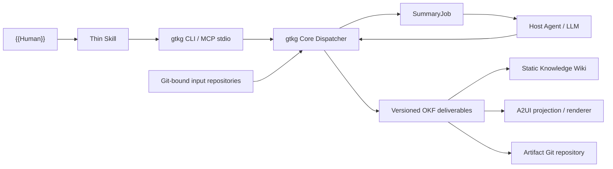
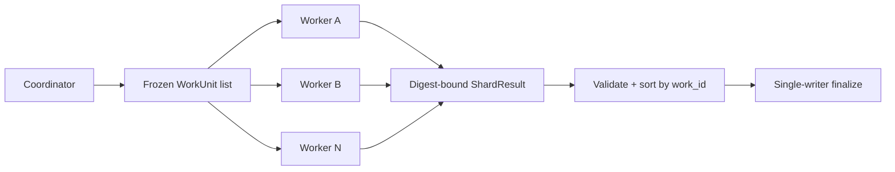

# GTKG 架构设计 V0.1

> 模板状态：`draft`  
> 实施状态：`not_run`  
> 验证状态：`not_run`

本文件是架构设计交付物模板，不是正式架构结论。生成正式版本时必须替换全部 `{{...}}` 占位符，并将每项声明关联到来源、决策或验证状态。仅创建、填写或评审本模板，不得被解释为代码实现、构建通过、Sandbox 生效、Git 发布完成或 A2UI 复刻已验证。

## 0. 模板使用合同 {#template-contract}

### 0.1 输入锁

| 锁 | Exact 值 | Digest | Git 身份/Commit | 状态 |
|---|---|---|---|---|
| CoreLock | `{{core_version}}` | `{{core_digest}}` | `{{core_git_identity}}@{{core_commit}}` | `{{observed/not_run}}` |
| SkillLock | `{{skill_version}}` | `{{skill_digest}}` | `{{skill_git_identity}}@{{skill_commit}}` | `{{observed/not_run}}` |
| TemplateLock | `V0.1` | `{{template_manifest_digest}}` | `{{template_git_identity}}@{{template_commit}}` | `{{observed/not_run}}` |
| SourceLock[] | `{{source_versions}}` | `{{source_digests}}` | `{{source_git_locks}}` | `{{observed/not_run}}` |
| NodeSetLock | `{{node_set_version}}` | `{{node_set_digest}}` | `{{registry_commit}}` | `{{not_run}}` |
| SandboxPolicyLock | `{{sandbox_policy_version}}` | `{{sandbox_policy_digest}}` | `{{policy_commit}}` | `{{not_run}}` |
| A2UILock | `{{a2ui_version}}` | `{{a2ui_lock_digest}}` | `{{catalog_renderer_identity}}` | `{{not_run}}` |

### 0.2 填写规则

- 所有正式结论必须标注 `observed | inferred | proposed | not_run | blocked`。
- `not_run`、`blocked`、`stale` 和 `failed` 不得写成 `passed`。
- 正式版本不得引用 `latest`、`current`、`main` 等浮动标识作为持久锁。
- OKF canonical knowledge 与 JSON/NDJSON/HTML/A2UI 投影必须分开描述。
- 本架构文档不得引入数据库、远程节点或第二个发布二进制等未确认范围。

## 1. 文档控制 {#document-control}

| 字段 | 内容 |
|---|---|
| 产品 | Goal-Team Knowledge Graph（GTKG） |
| 文档版本 | V0.1 |
| 需求基线 | R3.3-D1 |
| 架构状态 | `{{draft/reviewed/approved}}` |
| 实施状态 | `not_run` |
| 目标读者 | `{{产品经理/架构师/开发 Agent/应用 Agent/运维/审核者}}` |
| 作者/评审者 | `{{author}} / {{reviewers}}` |
| 生效条件 | `{{approval_and_exact_lock_conditions}}` |
| 替代文档 | `{{none_or_exact_version}}` |

### 1.1 变更记录

| 版本 | 日期 | 变更 | 决策人 | 证据/Issue |
|---|---|---|---|---|
| V0.1 | `{{date}}` | `{{initial_architecture_design}}` | `{{owner}}` | `{{evidence_ref}}` |

## 2. 执行摘要 {#executive-summary}

用不超过 `{{word_limit}}` 字说明：

- 架构要解决的核心问题：`{{problem_summary}}`
- 选择 Rust CLI/MCP Core + 薄 Skill 的原因：`{{rationale}}`
- 单一 `gtkg` 二进制和 file-only OKF 的关键收益：`{{benefits}}`
- 主要约束与尚未验证事项：`{{constraints_and_not_run}}`
- V0.1 最重要的风险：`{{top_risks}}`

## 3. 架构目标与原则 {#architecture-goals-principles}

### 3.1 架构目标

| ID | 目标 | 消费者 | 可测量指标 | 当前状态 |
|---|---|---|---|---|
| AG-01 | `{{知识产物可由人和 Agent 渐进读取}}` | `{{consumer}}` | `{{metric}}` | `proposed` |
| AG-02 | `{{CLI 与 MCP 同核同合同}}` | `{{consumer}}` | `{{metric}}` | `proposed` |
| AG-03 | `{{无数据库也可确定性构建和恢复}}` | `{{consumer}}` | `{{metric}}` | `proposed` |
| AG-04 | `{{来源、模板、产物三域 Git 可追溯}}` | `{{consumer}}` | `{{metric}}` | `proposed` |
| AG-05 | `{{多节点并行但单写者确定性归并}}` | `{{consumer}}` | `{{metric}}` | `proposed` |
| AG-06 | `{{前端知识可投影为 A2UI}}` | `{{consumer}}` | `{{metric}}` | `proposed` |

### 3.2 架构原则

为每条原则填写“约束、例外、验证方式”：

1. **OKF canonical，投影可重建**：`{{principle_details}}`
2. **单二进制、同一 Dispatcher**：`{{principle_details}}`
3. **模板先行、exact lock**：`{{principle_details}}`
4. **Git identity before claims**：`{{principle_details}}`
5. **Coordinator 单写者**：`{{principle_details}}`
6. **Sandbox fail-closed**：`{{principle_details}}`
7. **增量结果等价于全量重建**：`{{principle_details}}`
8. **证据状态不越级**：`{{principle_details}}`
9. **Progressive loading by contract**：`{{principle_details}}`
10. **目标仓库内容一律视为不可信数据**：`{{principle_details}}`

## 4. 范围、非目标与约束 {#scope}

### 4.1 V0.1 范围

| 能力 | In/Out | 说明 | 架构影响 |
|---|---|---|---|
| 单 `gtkg` 二进制 | In | `{{detail}}` | `{{impact}}` |
| CLI + MCP stdio | In | `{{detail}}` | `{{impact}}` |
| 本地多节点 exec/MCP stdio | In | `{{detail}}` | `{{impact}}` |
| OKF v0.2 与 file-only 索引 | In | `{{detail}}` | `{{impact}}` |
| 静态 Knowledge Wiki | In | `{{detail}}` | `{{impact}}` |
| Frontend IR/A2UI 投影 | In | `{{detail}}` | `{{impact}}` |
| 数据库/向量库/消息队列 | Out | 禁止 | `{{enforcement}}` |
| HTTP/TCP/SSH/P2P/HA | Out | V0.1 不提供 | `{{enforcement}}` |
| 任意目标代码执行 | Out | 禁止 | `{{enforcement}}` |
| 通用 100% 像素复刻承诺 | Out | 禁止 | `{{enforcement}}` |

### 4.2 外部约束

- 首个 SB2 目标平台：`{{unconfirmed_target_platform}}`
- 首批解析器矩阵：`{{unconfirmed_parser_matrix}}`
- A2UI renderer/catalog：`{{unconfirmed_exact_binding}}`
- Git 仓库/分支/写入边界：`{{unconfirmed_git_boundary}}`
- 资源、时间和容量预算：`{{budget}}`

## 5. 系统上下文视图 {#context}

### 5.1 参与者与外部系统

| 元素 | 类型 | 信任级别 | 输入 | 输出 | 责任边界 |
|---|---|---|---|---|---|
| 人类用户 | Actor | `{{level}}` | `{{input}}` | `{{output}}` | `{{boundary}}` |
| 宿主 Agent/LLM | External runtime | `{{level}}` | SummaryJob | SummaryResult | `{{boundary}}` |
| 薄 Skill | Adapter/orchestrator | `{{level}}` | 用户意图 | OperationRequest | 不实现业务规则 |
| `gtkg` | System | trusted binary after lock | OperationRequest | OKF/bundle/receipt | 核心边界 |
| 输入 Git 仓库 | External source | untrusted content | 文件/commit | SourceLock | 禁止执行源码 |
| Artifact Git 仓库 | External sink | `{{level}}` | immutable bundle | commit/tag/receipt | 需单独写授权 |
| A2UI renderer | External runtime | `{{level}}` | A2UI JSONL | UI/evidence | exact digest lock |

### 5.2 上下文图



补充上下文边界、数据流和禁止流：`{{context_notes}}`

## 6. 逻辑视图 {#logical-view}

### 6.1 单发布二进制

正式设计必须确认只发布一个程序：

```text
gtkg <group> <verb>
gtkg op <operation-id> --request <request.json> --output json
gtkg mcp serve --stdio
gtkg node serve --stdio
```

描述入口复用、依赖方向和禁止的额外 release binary：`{{single_binary_design}}`

### 6.2 五 crate 逻辑分层

| Crate | 必要责任 | 禁止责任 | 主要依赖 | 验证状态 |
|---|---|---|---|---|
| `gtkg-protocol` | ID、Schema、Operation、错误、digest 类型 | IO/业务编排 | `{{deps}}` | `not_run` |
| `gtkg-extract` | 文档、代码、前端静态提取 | 执行目标源码、发布 | `{{deps}}` | `not_run` |
| `gtkg-core` | Dispatcher、工作流、OKF、模板、图、索引、Git、A2UI | transport 特有语义 | `{{deps}}` | `not_run` |
| `gtkg-app` | CLI、MCP stdio、node stdio adapter | 重复业务规则 | `{{deps}}` | `not_run` |
| `gtkg-testkit` | fixtures、Harness、故障注入 | 进入正式 runtime 依赖 | `{{deps}}` | `not_run` |

### 6.3 Core 模块

为下列模块填写输入、输出、副作用和所有者：

| 模块 | 输入 | 输出 | 副作用等级 | 备注 |
|---|---|---|---|---|
| dispatcher | `{{input}}` | `{{output}}` | `{{class}}` | `{{note}}` |
| inventory/source_lock | `{{input}}` | `{{output}}` | `{{class}}` | `{{note}}` |
| planner/impact | `{{input}}` | `{{output}}` | `{{class}}` | `{{note}}` |
| template/okf | `{{input}}` | `{{output}}` | `{{class}}` | `{{note}}` |
| summary | `{{input}}` | `{{output}}` | `{{class}}` | Rust 不直接调用网络 LLM |
| graph/index | `{{input}}` | `{{output}}` | `{{class}}` | file-only |
| federation/sandbox | `{{input}}` | `{{output}}` | `{{class}}` | `{{note}}` |
| frontend/a2ui | `{{input}}` | `{{output}}` | `{{class}}` | `{{note}}` |
| bundle/git/current | `{{input}}` | `{{output}}` | `{{class}}` | Coordinator only |
| run/event reducer | `{{input}}` | `{{output}}` | `{{class}}` | append-only source |

### 6.4 依赖规则

```text
gtkg-app -> gtkg-core -> gtkg-protocol
gtkg-core -> gtkg-extract -> gtkg-protocol
gtkg-testkit -> all production crates (dev-only)
```

记录允许依赖、禁止反向依赖和静态检查：`{{dependency_rules}}`

## 7. Operation 合同与 CLI/MCP 等价性 {#operations}

### 7.1 Transport-neutral envelope

```json
{
  "protocol_version": "{{exact_protocol_version}}",
  "operation_id": "{{group.verb}}",
  "request_id": "{{stable_request_id}}",
  "run_id": "{{optional_run_id}}",
  "locks": {},
  "payload": {}
}
```

定义 `OperationRequest`、`OperationResponse` 和 `ErrorEnvelope` 的完整 Schema 引用：`{{schema_refs}}`

### 7.2 Operation 清单

| 分组 | Operation | CLI 映射 | MCP Tool 映射 | Side-effect class | Idempotency | Owner |
|---|---|---|---|---|---|---|
| System | `system.describe` | `{{cli}}` | `{{mcp}}` | read | safe | `{{owner}}` |
| Build | `{{operation}}` | `{{cli}}` | `{{mcp}}` | `{{class}}` | `{{rule}}` | `{{owner}}` |
| Template | `{{operation}}` | `{{cli}}` | `{{mcp}}` | `{{class}}` | `{{rule}}` | `{{owner}}` |
| Deliverable | `{{operation}}` | `{{cli}}` | `{{mcp}}` | `{{class}}` | `{{rule}}` | `{{owner}}` |
| Node | `{{operation}}` | `{{cli}}` | `{{mcp}}` | `{{class}}` | `{{rule}}` | `{{owner}}` |
| A2UI | `{{operation}}` | `{{cli}}` | `{{mcp}}` | `{{class}}` | `{{rule}}` | `{{owner}}` |

正式版本必须列出 R3.3-D1 的全部公开 Operation，并把内部 `node.work.execute` 标为非 Skill-facing。

### 7.3 等价性不变量

- CLI 与 MCP 进入同一个 `Dispatcher`：`{{design_evidence}}`
- request/response/error JSON Schema 完全一致：`{{contract_test_plan}}`
- 不允许 transport 特有业务分支：`{{enforcement}}`
- MCP V0.1 仅 stdio Tools：`{{negative_scope_check}}`
- provider 在产生 `run_id` 后固定：`{{pinning_rule}}`

## 8. 部署与多节点视图 {#deployment-view}

### 8.1 部署模式

| 模式 | Coordinator | Worker | Transport | 适用场景 | 状态 |
|---|---|---|---|---|---|
| 单节点 | 同一 `gtkg` 实例 | 同进程/无独立 Worker | local call | `{{scenario}}` | `not_run` |
| 本地多节点 | 一个 `gtkg` | N 个同版本 `gtkg` | exec / MCP stdio | `{{scenario}}` | `not_run` |

### 8.2 节点描述与握手

每个 `NodeDescriptor` 必须包含：

- `node_id`、`logical_address`、transport、endpoint
- binary、source、protocol、parser、sandbox digest
- capability、max parallel、platform
- trust policy、allowed work class、health/expiry

补充握手、兼容矩阵和 `NodeSetLock` 生成规则：`{{node_handshake_design}}`

### 8.3 调度与确定性归并



必须定义：稳定 `work_id`、纯工作重试、重复结果消歧、不同 digest 阻断、Worker 禁止写入范围。填写：`{{federation_rules}}`

## 9. Sandbox 架构 {#sandbox}

### 9.1 Assurance levels

| 等级 | 最低保证 | 允许场景 | 禁止声明 | Provider/平台 | 状态 |
|---|---|---|---|---|---|
| SB0 | 逻辑路径与 Schema guard | 受信测试 | OS 隔离 | `{{provider}}` | `not_run` |
| SB1 | 清洁环境、scratch、timeout/resource limit | 受控输入 | 可安全处理不可信输入 | `{{provider}}` | `not_run` |
| SB2 | OS 强制只读输入、no-exec、网络禁止、进程/资源隔离 | 不可信文档/源码 | 未验证平台的安全承诺 | `{{provider}}` | `not_run` |

### 9.2 SandboxProvider 合同

定义 `describe`、`probe`、`execute`、`receipt`：`{{provider_contract}}`

### 9.3 默认拒绝项

- 网络、HOME、SSH、Git、LLM 凭证和非白名单环境变量
- 目标源码/宏/插件/文档脚本执行
- 输入树写入、路径穿越和 symlink escape
- 超出 WorkUnit 声明的进程、时间、内存和输出
- 需求为 SB2 时降级到 SB0/SB1

记录失败错误码和恶意 Harness：`{{sandbox_failure_and_tests}}`

## 10. 数据与知识视图 {#data-view}

### 10.1 权威数据与投影

| 数据类型 | 格式 | 权威性 | 可删除重建 | 写者 |
|---|---|---|---|---|
| Canonical knowledge | OKF Markdown + YAML frontmatter | SSOT | 否 | Coordinator |
| Template packages | versioned OKF | SSOT | 否 | template publisher |
| Locks/manifests/receipts | JSON/NDJSON/YAML | 控制与证据 | 部分 | Coordinator |
| Catalog/path/graph/search | NDJSON | 投影 | 是 | index builder |
| Static Wiki | HTML/CSS/JS/assets | 投影 | 是 | projection builder |
| A2UI streams | JSONL | 投影 | 是 | A2UI compiler |
| `.gtkg` run/cache | ordinary files | 临时状态 | 是 | local runtime |

数据库、KV、向量库、消息队列、opaque index segment：**禁止**。记录依赖扫描和 magic-header 验证：`{{no_database_enforcement}}`

### 10.2 核心对象

为下列对象提供 Schema、生命周期和引用完整性：

`RepositoryIdentity`、`SourceSnapshot`、`PathScope`、`SourceManifestEntry`、`AnalysisPacket`、`SummaryJob`、`SummaryResult`、`WorkUnit`、`ShardResult`、`OKFConcept`、`KnowledgeEntity`、`KnowledgeRelation`、`FrontendSemanticIR`、`A2UIBinding`、`ArtifactManifest`、`PublicationReceipt`、`ActivationReceipt`。

填写：`{{data_object_catalog_ref}}`

### 10.3 Lock 模型

| Lock | 保护对象 | 必须包含 | 漂移行为 |
|---|---|---|---|
| CoreLock | `{{object}}` | exact version + digest + Git commit | `{{behavior}}` |
| SkillLock | `{{object}}` | exact version + digest + Git commit | `{{behavior}}` |
| SourceLock | `{{object}}` | repo identity/tree/dirty/submodules/path digest | `{{behavior}}` |
| TemplateLock | `{{object}}` | template ID/version/manifest digest | `{{behavior}}` |
| NodeSetLock | `{{object}}` | exact node descriptors/capabilities/digests | `{{behavior}}` |
| SandboxPolicyLock | `{{object}}` | level/provider/policy digest | `{{behavior}}` |
| A2UILock | `{{object}}` | spec/schema/catalog/renderer digest | `{{behavior}}` |

## 11. OKF Profile 与渐进加载 {#okf-profile}

### 11.1 OKF v0.2 基线

说明官方字段、GTKG `gtkg:` 扩展边界和 Schema 引用：`{{okf_profile_design}}`

### 11.2 严格生产者规则

- 每个发布目录必须有 `index.md`。
- 每个直接子文件/目录在父索引中恰好有一条记录。
- Root `index.md` 声明 `okf_version: "0.2"`。
- Knowledge ID 稳定，revision 单调演进。
- 文件 digest 由外部 manifest/父索引绑定，禁止自包含 digest。
- 关系必须 typed、可解析并带 evidence/ref。

定义 L0/L1/L2/L3 加载预算、索引分片和“不得全库载入”规则：`{{progressive_loading_design}}`

## 12. 模板与交付物版本 {#template-deliverable-versioning}

### 12.1 Template-first gate

任何外部交付物生成前必须完成：

```text
template.resolve -> template.prefetch -> TemplateLock -> build.plan
```

定义 canonical template、derived template、draft、slot override 和发布规则：`{{template_lifecycle}}`

### 12.2 不可变版本目录

```text
templates/packages/<template-id>/versions/v<semver>--<digest12>/...
deliverables/<deliverable-id>/versions/v<semver>--<digest12>/...
```

`CURRENT.json` 仅用于发现；持久引用必须 exact version + digest。填写原子发布、冲突和回滚规则：`{{versioning_rules}}`

### 12.3 人工修改

定义 `draft -> validate -> derive -> publish`、稳定 slot ID、单父派生和 `verified` 独立状态：`{{human_edit_rules}}`

## 13. Git 三域绑定与发布对象链 {#git-binding}

### 13.1 三域身份

| 域 | 必须锁定 | Dirty 处理 | 验证 |
|---|---|---|---|
| G1 Core/Skill source | repo identity、commit、tree、subtree/binary/schema digest | `{{rule}}` | `{{verification}}` |
| G2 Input repositories | remote identity、commit、tree、dirty、submodules、path manifest | `{{rule}}` | `{{verification}}` |
| G3 Artifact repository | manifest、commit、tag、receipt、activation commit | `{{rule}}` | `{{verification}}` |

### 13.2 发布对象链

```text
Artifact Manifest M
  -> Artifact Commit C
  -> Git Note Receipt R(C,M)
  -> Annotated Tag T(C,R)
  -> Activation Commit A(C,T,R)
```

解释避免 commit 自引用、exact readback、append-only activation 和回滚新提交：`{{git_object_chain_design}}`

### 13.3 授权边界

本架构文档的生成不授权 Git 初始化、commit、tag、note、push、PR、Release 或 Current 激活。正式实现阶段的授权：`{{authorization_record_or_not_authorized}}`

## 14. 全量、增量与多仓流程 {#incremental-build}

### 14.1 Pipeline

```text
source.inspect
-> template.resolve/prefetch
-> build.plan
-> build.prepare
-> sandboxed WorkUnits
-> summary.next / host LLM / summary.accept
-> build.finalize
-> bundle.verify
-> git.publish
-> current.activate
```

为每阶段填写输入锁、输出、写者、失败点和补偿动作：`{{pipeline_stage_table_ref}}`

### 14.2 增量算法

```text
sorted baseline source-manifest.ndjson
+ sorted current source-manifest.ndjson
-> merge-join added/changed/deleted/unchanged
-> impact closure
-> affected canonical regeneration
-> complete index reconstruction
-> deterministic reduce
```

必须证明相同 locks 下：`incremental final manifest digest == fresh full rebuild manifest digest`。设计与验证方法：`{{incremental_equivalence}}`

### 14.3 多仓比较与 Snapshot

定义仓库对齐、差异分类、冲突、备份、restore verification 和输出知识类型：`{{multi_repo_snapshot_design}}`

## 15. 静态 Knowledge Wiki {#wiki}

### 15.1 信息架构

```text
左侧：目录/实体/关系/搜索索引
右侧：按需加载的 OKF 内容、证据、冲突和版本
```

填写路由、深链接、版本选择、空状态、错误状态和 provenance 展示：`{{wiki_information_architecture}}`

### 15.2 加载模型

- 首屏仅加载 root catalog、导航骨架和当前文档。
- 目录、关系、搜索 shard 和正文按需读取。
- 10k 文件场景禁止首屏全量扫描。
- Wiki 不依赖数据库、应用服务器或写 API。

定义预算、缓存和离线行为：`{{wiki_loading_budget}}`

### 15.3 浏览器安全

说明 Markdown/HTML/SVG sanitize、CSP、相对资源路径、URL allowlist、action 禁止和 XSS 测试：`{{wiki_security}}`

## 16. Frontend Semantic IR 与 A2UI {#frontend-a2ui}

### 16.1 前端抽取与 IR

```text
Frontend SourceLock
-> observed static facts
-> Frontend Semantic IR
-> OKF app/route/component summaries
-> A2UI projection
```

IR 必须覆盖 App、Route、Surface、Component、Layout、StyleToken、Asset、Interaction、DataBinding、UIState、Accessibility、EvidenceRef。每项事实标注：`observed_static | resolved_static | inferred | runtime_verified`。

填写 IR Schema 与 provenance 规则：`{{frontend_ir_design}}`

### 16.2 A2UI exact binding

| 锁项 | Exact 值 | Digest | 状态 |
|---|---|---|---|
| A2UI spec | `0.9.1` | `{{spec_digest}}` | `{{observed/not_run}}` |
| Message schema/profile | `{{exact_version}}` | `{{schema_digest}}` | `not_run` |
| Component catalog | `{{catalog_version}}` | `{{catalog_digest}}` | `not_run` |
| Renderer | `{{renderer_version}}` | `{{renderer_digest}}` | `not_run` |

### 16.3 动态 surface 加载

描述 manifest、capability handshake、`createSurface`、`updateComponents`、`updateDataModel`、action、route-on-demand、`deleteSurface`：`{{a2ui_loading_design}}`

### 16.4 映射与证据等级

每个组件映射标记 `exact | approximation | unsupported`。证据不得越级：

1. `a2ui_ready_summary`
2. `a2ui_generatable`
3. `renderer_replicable`
4. `verified_replica`

锁定 viewport、DPR、theme、locale、fixtures、state、browser 和阈值的策略：`{{visual_evidence_design}}`

## 17. 状态机与并发控制 {#state-machines}

### 17.1 Run 状态机

```text
created -> inspected -> planned -> prepared
-> awaiting_summary -> ready_to_finalize
-> finalized -> verified -> published -> activated

terminal: cancelled | failed | blocked
```

定义合法 transition、幂等重放、append-only event 和唯一 reducer：`{{run_state_machine}}`

### 17.2 其他状态机

| 对象 | 状态序列 | 唯一写者 | 不变量 |
|---|---|---|---|
| Template/Deliverable | `draft -> validated -> committed -> published -> current/deprecated` | `{{writer}}` | `{{invariant}}` |
| WorkUnit | `planned -> assigned -> sandboxed -> executing -> validating -> accepted/rejected` | `{{writer}}` | `{{invariant}}` |
| A2UI evidence | 四级单调证据状态 | `{{writer}}` | 禁止无 receipt 升级 |

## 18. 失败处理与恢复 {#failure-recovery}

### 18.1 失败分类

| 类别 | 示例 | Retry | 补偿/恢复 | 阻断范围 |
|---|---|---|---|---|
| Validation | Schema/digest mismatch | 否 | `{{action}}` | `{{scope}}` |
| Sandbox | assurance unavailable/violation | 否 | `{{action}}` | `{{scope}}` |
| Worker | timeout/crash | 仅纯幂等工作 | `{{action}}` | WorkUnit 后继 |
| Determinism | 同 work ID 不同 digest | 否 | 全 run blocked | 全 finalize |
| Filesystem | partial candidate write | `{{rule}}` | `{{atomic_recovery}}` | candidate |
| Git | push/readback mismatch | `{{rule}}` | 保留未激活版本 | publish/activate |
| A2UI | renderer/catalog mismatch | `{{rule}}` | stale projection | 不必破坏 canonical OKF |

### 18.2 Checkpoint 与恢复

描述不可变 WorkUnit、candidate staging、原子 rename、事件 replay、resume token、cleanup 和人工恢复 runbook：`{{recovery_design}}`

## 19. 安全架构 {#security}

### 19.1 威胁模型

至少覆盖：恶意文档、仓库提示注入、路径穿越、symlink escape、压缩炸弹、宏/插件、凭证泄露、命令拼接、A2UI action 注入、XSS、供应链漂移、Worker 伪造和 Git 身份替换。

威胁表：`{{threat_model_ref}}`

### 19.2 信任边界与控制

| 边界 | 资产 | 威胁 | 预防 | 检测 | 证据状态 |
|---|---|---|---|---|---|
| Skill -> Core | Operation/locks | `{{threat}}` | `{{control}}` | `{{detection}}` | `not_run` |
| Core -> Worker | WorkUnit/source | `{{threat}}` | `{{control}}` | `{{detection}}` | `not_run` |
| Host LLM -> Core | SummaryResult | `{{threat}}` | `{{control}}` | `{{detection}}` | `not_run` |
| OKF -> Browser | content/assets | `{{threat}}` | `{{control}}` | `{{detection}}` | `not_run` |
| Local -> Git remote | artifacts/identity | `{{threat}}` | `{{control}}` | `{{detection}}` | `not_run` |

### 19.3 密钥与隐私

描述默认不读取凭证、环境变量 allowlist、敏感数据标记、日志脱敏、产物 sensitivity 和删除策略：`{{secrets_privacy_design}}`

## 20. 可观测性与审计 {#observability}

### 20.1 事件与 Receipt

| 信号 | 格式 | 必填字段 | 保留/轮转 | 消费者 |
|---|---|---|---|---|
| Run event | NDJSON | run/request/work ID、locks、state、timestamp | `{{policy}}` | reducer/auditor |
| Operation log | structured JSON | operation、duration、result/error | `{{policy}}` | operator |
| SandboxReceipt | JSON | provider、level、policy digest、limits、exit | `{{policy}}` | verifier |
| Node receipt | JSON | node/binary/protocol/parser digests | `{{policy}}` | coordinator |
| PublicationReceipt | JSON + Git note | M/C/R/T/A refs | append-only | auditor |
| A2UI evidence | JSON/OKF/screenshots | renderer/environment/threshold | `{{policy}}` | reviewer |

### 20.2 指标与诊断

定义 build duration、queue depth、worker utilization、cache hit、changed/affected ratio、summary round、projection load、failure class 和 evidence freshness：`{{metrics_design}}`

不得把 metrics/logs 写成数据库依赖。诊断包必须可脱敏、可验证、可按 run 导出：`{{diagnostic_bundle}}`

## 21. 容量、性能与扩展边界 {#capacity}

| 维度 | V0.1 目标 | Hard limit | 降级方式 | 测试状态 |
|---|---|---|---|---|
| 文件数 | 10,000 | `{{limit}}` | shard/progressive load | `not_run` |
| 单文件大小 | `{{target}}` | `{{limit}}` | `{{behavior}}` | `not_run` |
| 仓库数 | `{{target}}` | `{{limit}}` | `{{behavior}}` | `not_run` |
| Worker 数 | `{{target}}` | `{{limit}}` | `{{behavior}}` | `not_run` |
| 并发 WorkUnit | `{{target}}` | `{{limit}}` | backpressure | `not_run` |
| Wiki 首屏 | `{{budget}}` | `{{limit}}` | lazy load | `not_run` |
| A2UI surface | `{{budget}}` | `{{limit}}` | route/surface on demand | `not_run` |

说明复杂度、内存上界、磁盘预算、NDJSON shard 规则和 10,001 边界行为：`{{capacity_design}}`

## 22. 架构决策摘要 {#architecture-decisions}

| ADR | 决策 | 状态 | 主要替代项 | 选择理由 | 后果 |
|---|---|---|---|---|---|
| ADR-001 | 单发布二进制 `gtkg` | accepted baseline | 多二进制 | `{{rationale}}` | `{{consequence}}` |
| ADR-002 | CLI/MCP 共用 Dispatcher | accepted baseline | 双业务栈 | `{{rationale}}` | `{{consequence}}` |
| ADR-003 | OKF/file-only，不使用数据库 | accepted baseline | SQL/KV/vector DB | `{{rationale}}` | `{{consequence}}` |
| ADR-004 | Coordinator 单写者、多 Worker | accepted baseline | P2P/多写者 | `{{rationale}}` | `{{consequence}}` |
| ADR-005 | 模板先行与不可变交付版本 | accepted baseline | 就地修改 | `{{rationale}}` | `{{consequence}}` |
| ADR-006 | Git 三域对象链 | accepted baseline | 仅记录 commit | `{{rationale}}` | `{{consequence}}` |
| ADR-007 | Semantic IR 后投影 A2UI | accepted baseline | 直接从源码生成 UI | `{{rationale}}` | `{{consequence}}` |
| ADR-008 | SB2 fail-closed | accepted baseline | 自动降级 | `{{rationale}}` | `{{consequence}}` |

每个 ADR 需在附录中补齐 Context、Decision、Options、Consequences、Validation、Supersedes/Superseded by。

## 23. 详细 ADR 模板 {#adr}

### ADR-{{NNN}}：{{title}}

- **Status**：`proposed | accepted | deprecated | superseded`
- **Context**：`{{context}}`
- **Decision drivers**：`{{drivers}}`
- **Considered options**：`{{options}}`
- **Decision**：`{{decision}}`
- **Positive consequences**：`{{positive}}`
- **Negative consequences**：`{{negative}}`
- **Security/privacy impact**：`{{impact}}`
- **Operational impact**：`{{impact}}`
- **Validation plan**：`{{plan_not_execution}}`
- **Current evidence state**：`not_run`
- **Supersedes / Superseded by**：`{{refs}}`

## 24. 实施序列（仅规划） {#implementation-sequence}

> 本节只描述未来实施顺序；当前全部工作项必须保持 `not_run`。不得把顺序规划表述为已创建 crate、已实现 Operation、已通过测试或已发布 Skill。

| 阶段 | 计划产物 | 前置 | 验收设计 | 实施状态 |
|---|---|---|---|---|
| M0 | 协议、Schema、RiskDenominator | R3.3-D1 | `{{acceptance}}` | `not_run` |
| M1 | 五 crate、单二进制空骨架 | M0 | `{{acceptance}}` | `not_run` |
| M2 | Git/Source/Template/OKF 基础 | M1 | `{{acceptance}}` | `not_run` |
| M3 | 文档/代码/前端提取与无 DB 索引 | M2 | `{{acceptance}}` | `not_run` |
| M4 | SB2、多节点与确定性归并 | M1-M3 | `{{acceptance}}` | `not_run` |
| M5 | 增量、版本、Git 对象链 | M2-M4 | `{{acceptance}}` | `not_run` |
| M6 | 静态 Wiki 与 A2UI projection | M3-M5 | `{{acceptance}}` | `not_run` |
| M7 | 10k、故障、forward 和独立验证 | M0-M6 | `{{acceptance}}` | `not_run` |

实施 TaskExactSet/DAG 引用：`{{task_exact_set_ref}}`

## 25. 验收与证据计划（未执行） {#acceptance}

| AC | 架构声明 | 验证方法 | Required receipt | 当前状态 |
|---|---|---|---|---|
| AC-ARCH-001 | 仅一个 release binary | release asset/dependency scan | `{{receipt}}` | `not_run` |
| AC-ARCH-002 | CLI/MCP 1:1 | contract parity matrix | `{{receipt}}` | `not_run` |
| AC-ARCH-003 | 不使用数据库 | dependency/output/magic scan | `{{receipt}}` | `not_run` |
| AC-ARCH-004 | 增量等价全量 | exact-lock digest comparison | `{{receipt}}` | `not_run` |
| AC-ARCH-005 | Worker 不能写 canonical | sandbox/adversarial test | `{{receipt}}` | `not_run` |
| AC-ARCH-006 | SB2 不降级 | unavailable/attack harness | `{{receipt}}` | `not_run` |
| AC-ARCH-007 | Git 三域可追溯 | M/C/R/T/A readback | `{{receipt}}` | `not_run` |
| AC-ARCH-008 | Wiki 渐进加载 | browser/10k test | `{{receipt}}` | `not_run` |
| AC-ARCH-009 | A2UI 证据不越级 | schema/renderer/evidence audit | `{{receipt}}` | `not_run` |
| AC-ARCH-010 | 失败可恢复且不激活 partial | fault injection | `{{receipt}}` | `not_run` |

Development、Release、安装、业务验证证据必须正交记录：`{{evidence_model_ref}}`

## 26. 风险、开放问题与决策门 {#risks-open-questions}

| ID | 风险/开放问题 | 影响 | 当前事实 | Owner | 决策门/截止 |
|---|---|---|---|---|---|
| R-01 | 首个 SB2 平台未确认 | 安全能力无法验收 | `{{fact}}` | `{{owner}}` | `{{gate}}` |
| R-02 | 首批解析器矩阵未确认 | 提取范围不稳定 | `{{fact}}` | `{{owner}}` | `{{gate}}` |
| R-03 | A2UI renderer/catalog 未锁定 | 复刻证据无法成立 | `{{fact}}` | `{{owner}}` | `{{gate}}` |
| R-04 | Artifact Git 边界未确认 | 发布对象链无法执行 | `{{fact}}` | `{{owner}}` | `{{gate}}` |
| R-05 | File-only 搜索容量风险 | 10k 查询体验 | `{{fact}}` | `{{owner}}` | `{{gate}}` |

## 27. 需求追踪矩阵 {#traceability}

| R3.3-D1 需求 | 架构章节 | ADR | Operation/Schema | AC | 状态 |
|---|---|---|---|---|---|
| CLI/MCP Core + 薄 Skill | 6、7 | ADR-001/002 | `{{ref}}` | AC-ARCH-001/002 | `proposed` |
| 无数据库、OKF file-only | 10、11 | ADR-003 | `{{ref}}` | AC-ARCH-003 | `proposed` |
| 多 CLI 并联互通 | 8 | ADR-004 | `{{ref}}` | AC-ARCH-005 | `proposed` |
| Sandbox | 9、19 | ADR-008 | `{{ref}}` | AC-ARCH-006 | `proposed` |
| 模板/交付物版本化 | 12 | ADR-005 | `{{ref}}` | `{{ac}}` | `proposed` |
| Git 三域强绑定 | 13 | ADR-006 | `{{ref}}` | AC-ARCH-007 | `proposed` |
| 增量/全量 | 14 | `{{adr}}` | `{{ref}}` | AC-ARCH-004 | `proposed` |
| 静态 Knowledge Wiki | 15 | `{{adr}}` | `{{ref}}` | AC-ARCH-008 | `proposed` |
| Frontend IR/A2UI | 16 | ADR-007 | `{{ref}}` | AC-ARCH-009 | `proposed` |

## 28. 完成检查表 {#completion-checklist}

- [ ] 全部 `{{...}}` 占位符已替换或明确标为 `not_applicable`。
- [ ] 所有外部声明都有 exact source、版本和 digest。
- [ ] 架构视图、ADR、Operation 和 AC 彼此可追踪。
- [ ] 明确只有一个发布二进制和五 crate。
- [ ] CLI/MCP 1:1 以及内部 Operation 边界完整。
- [ ] 多节点、Sandbox、单写者和确定性冲突规则完整。
- [ ] OKF/file-only 与数据库禁止项完整。
- [ ] 模板、交付物、Current 和人工派生规则完整。
- [ ] Git G1/G2/G3 与 M/C/R/T/A 对象链完整。
- [ ] 增量等价全量与删除传播完整。
- [ ] 静态 Wiki 渐进加载和浏览器安全完整。
- [ ] Frontend IR、A2UI 锁、动态加载和四级证据完整。
- [ ] 状态机、失败恢复、安全、可观测性和容量边界完整。
- [ ] 实施序列和全部实施/验证状态保持 `not_run`。
- [ ] 产品经理、架构师和独立审核者已完成文档评审。

## 附录 A：术语

| 术语 | 定义 |
|---|---|
| Canonical OKF | `{{definition}}` |
| Projection | `{{definition}}` |
| Operation | `{{definition}}` |
| WorkUnit | `{{definition}}` |
| SummaryJob | `{{definition}}` |
| Exact Lock | `{{definition}}` |
| Evidence state | `{{definition}}` |
| A2UI surface | `{{definition}}` |

## 附录 B：引用

| ID | 名称 | Exact version/commit | Digest | 用途 |
|---|---|---|---|---|
| REF-01 | OKF specification | `0.2 / {{commit}}` | `{{digest}}` | canonical knowledge profile |
| REF-02 | A2UI specification | `0.9.1 / {{commit}}` | `{{digest}}` | frontend projection |
| REF-03 | GTKG R3.3-D1 | `R3.3-D1` | `{{digest}}` | confirmed product baseline |
| REF-04 | CodeGraph/Qoder RepoWiki notes | `{{exact_ref}}` | `{{digest}}` | informative copy reference only |
